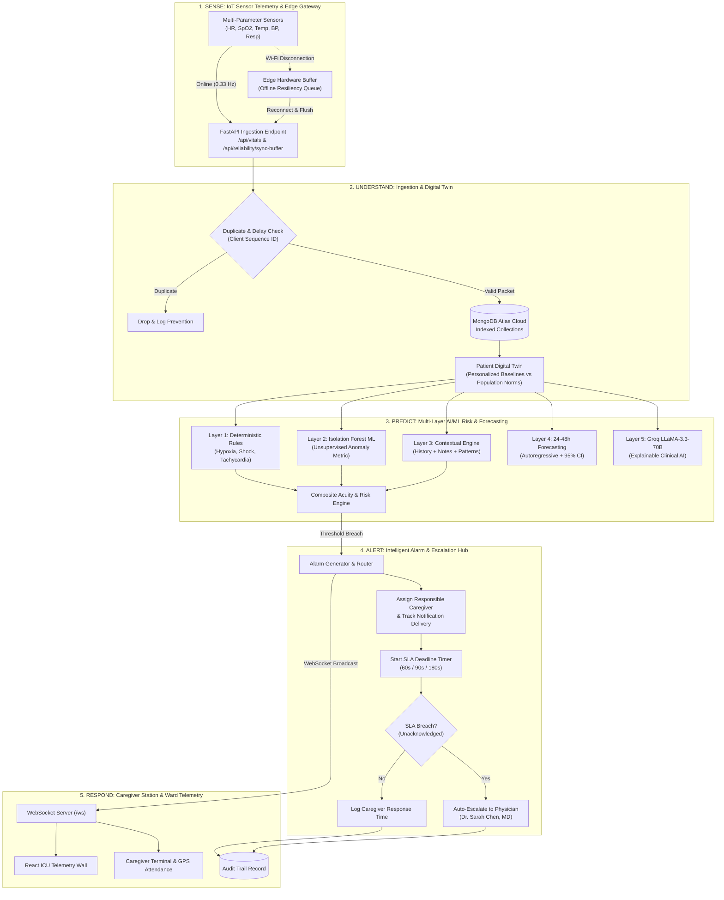
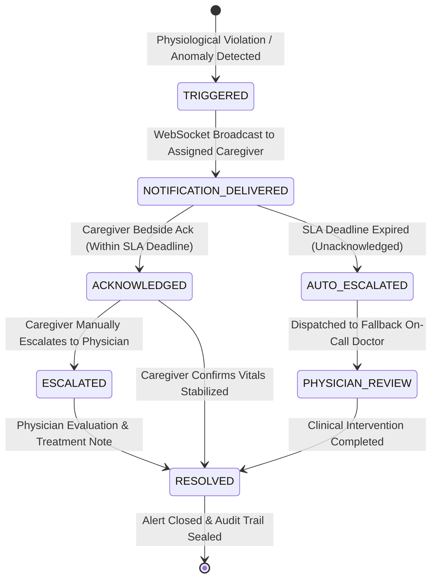
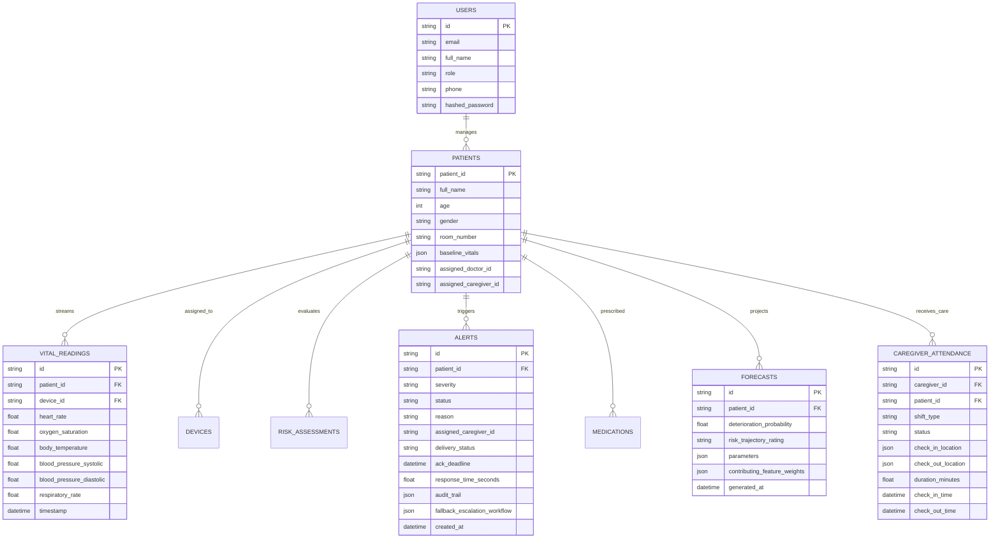

# MediGuard AI – Operation Ward Zero: System Architecture Specification

---

## 1. High-Level System Architecture

The following diagram illustrates the complete end-to-end telemetry and clinical decision-support pipeline implementing the **SENSE &rarr; UNDERSTAND &rarr; PREDICT &rarr; ALERT &rarr; RESPOND** architecture:

---

## 2. Alarm Lifecycle & SLA Fallback State Machine

---

## 3. Database Schema & Entity Relationships

---

## 4. Hardware Gateway Resilience & Buffering Model

When home Wi-Fi or cellular connectivity degrades:
1. **Edge Accumulation**: The simulated sensor hardware stores readings locally in flash memory tagged with incrementing `client_sequence_id` integers.
2. **Reconnection Handshake**: When the network restores, the gateway sends a batch sync request (`POST /api/reliability/sync-buffer`).
3. **De-duplication Check**: Backend checks incoming sequence IDs against indexed storage; duplicate packets are discarded without throwing errors.
4. **Delayed Data Flagging**: Packets recorded > 300 seconds prior to arrival are ingested with a `delayed: true` flag to prevent historical readings from falsely skewing real-time alarm thresholds.
5. **Watchdog Verification**: Central telemetry monitors the last transmission heartbeat; if no packets arrive for > 15 seconds, a `StaleSensorAlert` is triggered.
